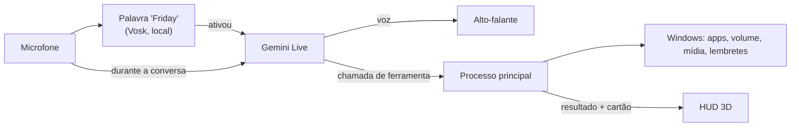

<div align="center">

# F.R.I.D.A.Y

**Assistente pessoal para Windows controlada 100% por voz, com HUD holográfico em 3D.**

*by Harle*

</div>

---

A FRIDAY fica discreta no canto da tela. Quando você diz **"Friday"**, o HUD se expande, ela ouve o pedido, age no seu PC e responde falando. Sem botões, sem janelas para clicar.

> **Status:** v0.1, em desenvolvimento ativo.

## O que ela faz

- **Conversa por voz em tempo real** com o Gemini Live: você pode interromper enquanto ela fala, como numa conversa normal.
- **Controla o PC:** abre e fecha programas, mexe no volume, controla músicas e vídeos, pesquisa na web e abre sites.
- **Lembretes** que ficam salvos e avisam na hora certa, mesmo depois de reiniciar o PC.
- **Status do sistema:** uso de CPU, RAM e placa de vídeo (NVIDIA).
- **Rotinas por voz, timers, lembretes repetidos, clima, modo foco e autodiagnóstico.**
- **Arquivos nas pastas pessoais:** listar, abrir, mover, renomear, criar pasta, mandar para a Lixeira e desfazer. Nunca sai das pastas pessoais, nunca sobrescreve e nunca abre programas ou scripts.
- **Memória que aprende** com as conversas, **cenas** da Wikipédia na tela e **tarefas de programação** com o Claude Code em segundo plano.
- **Modo explicação:** quando você pede uma explicação ou uma história, as palavras-chave aparecem gigantes, montadas em partículas, no instante em que ela as fala, com fotos, fatos e um carimbo de veredito.
- **Projeção 3D:** as partículas saem da fita e montam o objeto em holograma, como na cena da máquina do tempo. Formas da ciência, funções matemáticas, moléculas, proteínas, 257 modelos da NASA, STLs da Wikimedia, os seus arquivos e a IA para o resto.
- **Uma FRIDAY só no PC e no celular:** pareados, os avisos do celular saem no PC quando você está nele, o celular manda no PC (e liga o PC pela rede), a memória e a conversa continuam de um no outro, e os hologramas passam de uma tela para a outra.
- **Visão de Deus:** um globo 3D com aviões, satélites, navios, terremotos, câmeras públicas e radar de chuva ao vivo, aberto e controlado por voz.
- **Clima de qualquer lugar do mundo** (cidade, bairro, região, estado, país ou ponto turístico), agora e até 16 dias, e **busca na internet** pelo Google para notícias, jogos, preços e qualquer fato atual.
- **Saudação ao abrir** com o clima e os lembretes do dia, no máximo uma vez a cada 4 horas.
- **Cartões contextuais:** cada resposta mostra só o que importa (um medidor, um lembrete, o volume) e some sozinha.
- **Confirmação por voz** antes de ações perigosas, como fechar um programa.
- **Sons de interface** para você saber o que ela está fazendo mesmo sem olhar para a tela.
- **Estados visuais** para cada situação: ouvindo, pensando, falando, silenciada, sem conexão e sem microfone.

## O núcleo

O "rosto" da FRIDAY é um holograma de 9 mil partículas no formato de uma fita de Möbius, projetado de uma base com grade polar, feito com Three.js e shaders próprios. A fita reage ao nível real do áudio: ondula com a sua voz quando ela ouve, solta ondas de sonar quando fala e se transforma num nó toroidal quando está pensando.

Para não pesar nos jogos, o núcleo roda a 30 fps com o HUD aberto, cai para 15 fps parado no canto e pausa quando não está visível.

## Como funciona



- **Privacidade:** a palavra "Friday" é reconhecida no seu próprio PC. Nenhum áudio sai do computador antes disso.
- **Segurança:** a IA não roda comandos livres. Ela só escolhe ferramentas conhecidas, e os programas que ela pode abrir ficam numa lista que você controla (`apps.json`).
- **Latência:** o áudio dos instantes antes e durante a ativação é guardado e enviado assim que a conexão abre, então você pode falar "Friday, abre o Spotify" de uma vez só. O painel de sistema mostra a latência real de cada resposta.

## Instalação

Requisitos: Windows 10 ou 11, [Node.js](https://nodejs.org) 20 ou mais novo e um microfone.

**Jeito mais fácil:** baixe o [`instalar.bat`](instalar.bat) e dê dois cliques. Ele instala o que faltar, baixa o projeto, pede a sua chave do Gemini, monta a FRIDAY, cria o atalho **F.R.I.D.A.Y** no Menu Iniciar e já abre. A partir daí ela **abre sozinha quando o Windows liga** (sem janela de terminal). Para desligar isso, use o ícone da bandeja › *Iniciar com o Windows*. Para pegar as novidades, ícone da bandeja › *Atualizar a FRIDAY* (ou dois cliques no `atualizar.bat`).

**Passo a passo manual:**

```bash
git clone https://github.com/Harlezinhuu/F.R.I.D.A.Y.-by-Harle.git
cd F.R.I.D.A.Y.-by-Harle
npm install
npm run modelo        # baixa o reconhecedor da palavra "Friday" (~40 MB)
copy .env.example .env
```

Abra o `.env` e coloque sua chave do Gemini (grátis em [aistudio.google.com/apikey](https://aistudio.google.com/apikey)). Depois:

```bash
npm run dev           # roda em modo de desenvolvimento
npm run dist          # gera o instalador para Windows
npm test              # testes automáticos da lógica (lembretes, caminhos, rotinas, fala, memória, tarefas)
```

## Usando

Diga **"Friday"** e faça o pedido. Alguns exemplos:

| Você diz | Ela faz |
|---|---|
| "Friday, abre o Spotify" | Abre o programa e mostra o cartão |
| "Coloca o volume em 30" | Ajusta o volume do Windows |
| "Pula essa música" | Avança a faixa no player que estiver tocando |
| "Como tá a GPU?" | Mostra o uso de GPU, CPU e RAM |
| "Me lembra de mandar o relatório amanhã às nove" | Cria o lembrete |
| "Mostra o sistema completo" | Abre os painéis laterais |
| "Fecha o Discord" | Pede confirmação antes de fechar |
| "Pode descansar" | Encerra a conversa e volta para o canto |
| "Minimiza" / "volta pro canto" | Encolhe a FRIDAY na hora, como quando ela abre |
| "Todo dia às 8 me lembra de tomar água" | Lembrete repetido (todo dia, dias úteis, semanal ou mensal) |
| "Timer de 10 minutos para o macarrão" | Liga um timer e avisa falando |
| "Cria a rotina modo trabalho: abre o Chrome, abre o Spotify e diz bom trabalho" | Salva a rotina; depois é só dizer "modo trabalho" |
| "Tira um print" | Salva em Imagens/FRIDAY, sem o HUD aparecer |
| "O que tem nos meus downloads?" | Lista os arquivos mais recentes |
| "Move o contrato.pdf para documentos/contratos" | Move (nunca sobrescreve) e dá para desfazer |
| "Como está o tempo?" | Clima agora e do dia |
| "Modo foco de 50 minutos" | Timer no núcleo e lembretes guardados até o fim |
| "Como você está?" | Autodiagnóstico: microfone, ativação, cérebro, voz, internet e rapidez |
| "Eu gosto de café sem açúcar" | Ela aprende em silêncio e lembra nas próximas conversas |
| "O que você sabe sobre mim?" / "Esquece isso" / "Para de aprender" | Mostra, apaga ou pausa a memória |
| "Me fala da Torre Eiffel" | Responde e mostra foto e resumo da Wikipédia na tela |
| "Tarefa no projeto site: criar a página de contato" | O Claude Code programa em segundo plano e ela avisa quando terminar |
| "Como está a tarefa?" | Diz o andamento e a branch do resultado |

**Atalho de emergência:** `Ctrl + Alt + Espaço` silencia a FRIDAY na hora, de qualquer lugar. Aperte de novo para ela voltar a ouvir. O ícone na bandeja do Windows tem a opção **Sair**.

### Escolhendo a voz

Por padrão, a FRIDAY fala com a voz nativa do Gemini, que é a mais rápida. Para usar uma voz do [Fish Audio](https://fish.audio), coloque no `.env`:

```env
FRIDAY_VOZ_PROVEDOR=fish
FISH_API_KEY=sua_chave
FISH_VOZ_ID=id_da_voz
```

Nesse modo, o texto da resposta é cortado em frases e cada frase vira áudio assim que fica pronta, então ela começa a falar antes de terminar de pensar a resposta inteira. Em qualquer voz, `FRIDAY_EFEITO_VOZ=1` aplica uma camada de "voz de IA": presença, brilho digital, compressão de rádio e uma sala curta.

### Tarefas de programação

A FRIDAY entrega a tarefa ao [Claude Code](https://www.npmjs.com/package/@anthropic-ai/claude-code), que precisa estar instalado e com login feito no PC. Cada tarefa roda numa cópia isolada do projeto (`git worktree`) e o resultado fica numa branch `friday/tarefa-N-...` para você revisar: sem push e sem merge. O Claude Code só lê e edita arquivos; comandos de terminal, só os que você liberar.

Os projetos ficam em **Editar projetos de programação**, no ícone da bandeja:

```json
[
  { "nome": "Site", "pasta": "C:\\Users\\Harle\\Projetos\\site", "comandos": ["npm test", "npm run build"] }
]
```

### Memória

O que ela aprende fica só no seu PC (`memoria.json`, na pasta de configuração). Senhas, PINs, chaves, documentos e números de cartão ou conta são recusados antes de gravar.

### Modo explicação

Peça uma explicação, uma história, uma teoria ou "o que você faria" ("Friday, me explica como o Watergate foi descoberto"). A fita vira emissor no canto, um rio de partículas corre até um ponto de fuga cercado de linhas de radar e cada palavra-chave é montada em pontos, em perspectiva, **no momento em que a voz dela chega nela**; de uma palavra para a outra, as partículas voam e se rearrumam. Palavras de perigo, proibição ou mentira ficam vermelhas.

Ao lado entram fotos da Wikipédia (quando ela cita o assunto) e cartões com fatos curtos; à esquerda fica a trilha das palavras já ditas. Quando a explicação responde se algo é verdade, um carimbo cai no fim: **FALSO**, **MITO**, **VERDADE**... Uns segundos depois que ela termina, ou quando você volta a falar, tudo volta para a fita.

### Projeção 3D

Diga "Friday, projeta..." e as partículas saem da fita de Möbius, que encolhe e vira o emissor na base, para montar o objeto com o wireframe por cima.

| Peça | Exemplo |
|---|---|
| Formas da ciência | "projeta a fita de Möbius invertida", "um tesseract", "o sistema solar" (posições reais de hoje), "o atrator de Lorenz", "um buraco negro", "DNA", "átomo", "garrafa de Klein", "galáxia" |
| Funções | "projeta z igual seno de x vezes cosseno de y"; com t ela se mexe: "seno de x menos t" |
| Moléculas e proteínas | "projeta a molécula da cafeína" (PubChem), "a hemoglobina" (RCSB PDB) |
| NASA | "projeta a estação espacial", "o Hubble", "o Saturn V", "o Perseverance": 257 modelos de domínio público |
| Wikimedia | STLs abertos da Wikimedia Commons, com autor e licença na ficha |
| Seus arquivos | coloque `.glb`, `.gltf`, `.stl` ou `.obj` em **Documentos/FRIDAY Modelos** (ícone da bandeja → *Abrir pasta de modelos 3D*) e peça pelo nome |
| Qualquer outra coisa | a IA monta o objeto com peças simples e nomeadas |

Com o holograma na tela: **gira**, **para**, **vira para a esquerda/direita**, **vira de cabeça para baixo**, **vista de cima/de lado/de frente**, **aproxima/afasta**, **explode** (as peças se separam com etiquetas) e **junta**, **inverte** (como no filme, fica laranja), **corta** (corte transversal que varre o objeto), **renderiza** (ganha superfície: "Modelo renderizado"), **só as linhas**, **mede**, **salva** (vai para Imagens/FRIDAY) e **fecha**.

A projeção fica na tela mesmo quando a conversa acaba; diga "Friday, fecha a projeção" ou "minimiza".

#### Mexendo com as mãos

Diga "Friday, liga os gestos" (ou "quero mexer com as mãos"). A webcam liga, uma prévia aparece no canto e a imagem é processada só no seu PC pelo MediaPipe: nada de vídeo vai para a internet. A câmera desliga sozinha depois de um minuto e meio sem ver mãos, ou quando você diz "desliga os gestos".

| Gesto | O que faz |
|---|---|
| Mão fechada e mover | segura e gira o holograma |
| Pinça (polegar + indicador) subindo / descendo | aproxima / afasta |
| Duas mãos fechadas se afastando / aproximando | aumenta / diminui |
| Abrir as duas mãos abertas para os lados | explode as peças |
| Juntar as duas mãos abertas | monta de novo |
| Apontar com o indicador e parar em cima de uma peça | seleciona a peça (ela brilha e as outras apagam) |
| Tapa rápido com a mão aberta | joga o holograma para fora (fecha) |

Os modelos compactados com Draco (como os da NASA) são abertos pelo decodificador do próprio three.js, que vai junto com a FRIDAY e funciona offline.

### Visão de Deus

Diga "Friday, visão de Deus em Tóquio com os aviões" ou "mostra os terremotos no Japão em visão noturna". A FRIDAY abre o globo numa janela própria, já no lugar, nas camadas e no estilo pedidos. "Agora mostra Paris" troca só o lugar. "Fecha a visão de Deus" fecha a janela e desliga o servidor.

Na primeira vez, ela baixa e instala o projeto sozinha na pasta `extras` (leva alguns minutos) e abre quando terminar. Precisa do **Node 24.14 ou mais novo (fora o 25), ou do Node 26**, e do Git. Não precisa de chave nenhuma: o mapa usa a imagem de satélite da Esri.

Camadas: aviões, aviões militares, satélites, navios, terremotos, câmeras públicas, foguetes, radar de chuva, raios, ciclones, vento e trânsito. Estilos: normal, noturno, térmico, retrô, anime, noir e neve.

Só dados públicos de lugares, veículos e eventos. A FRIDAY não localiza nem rastreia pessoas.

O globo é o [God's Eye View](https://github.com/bilawalsidhu/gods-eye-view), de Bilawal Sidhu, sob licença MIT. Ele não faz parte deste repositório: é baixado do projeto original na primeira vez que você pede.

### Adicionando programas

Pelo ícone na bandeja, escolha **Editar programas permitidos**. Cada programa tem um nome, apelidos (como você fala) e o alvo que o Windows abre:

```json
{ "nome": "Valorant", "apelidos": ["valorant", "valo"], "alvo": "C:\\Riot Games\\Riot Client\\RiotClientServices.exe", "processo": "VALORANT.exe" }
```

Use `"processo": null` para programas que a FRIDAY pode abrir mas nunca fechar.

## FRIDAY no celular (Android)

Um app de assistente pessoal, como o do ChatGPT, com a voz e a personalidade da FRIDAY e um visual próprio, a direção **Órbita**: um mundo 3D só, com a fita de Möbius iridescente atrás de todas as telas, mudando de papel em cada uma (grande na voz, auréola no chat, vista de cima nas conversas), reagindo à voz e acompanhando a inclinação do celular.

- **Voz:** toque no botão e converse em tempo real (Gemini Live), com o núcleo de Möbius reagindo.
- **Chat:** respostas que chegam aos pedaços, com markdown, e histórico de conversas (as de voz também ficam salvas como texto).
- **Lembretes e timers** viram notificações do Android; **clima**, **pesquisa**, **memória** e **projeção 3D** (arraste para girar, pince para aproximar).
- **Controle do celular** por voz ou chat: abrir apps, lanterna, volume, tocar/pausar música, alarmes, brilho, Não perturbe, rotas no Maps, bateria, ligações, SMS e WhatsApp, agenda e contatos.
- **Mexer dentro dos apps:** com o controle da tela ativo (Acessibilidade), ela lê a tela e toca, escreve e rola em qualquer app ("abre o Spotify e procura Daft Punk").
- **Avisos por voz:** quando chega uma ligação, ela fala "Senhor, a Mãe está te ligando" (com a voz dela, pelo TTS do Gemini, mesmo com o app fechado); mensagens dos **contatos importantes** no WhatsApp, SMS, Telegram e outros também são avisadas, e ela pode ler o texto se você quiser. Fica quieta no modo silencioso e durante ligações; no Não perturbe, só avisa dos importantes. Diga "a Mãe é importante" ou adicione em Ajustes › Avisos por voz.
- **Assistente padrão:** segure o botão de ligar (ou de início) e a FRIDAY abre já ouvindo. Enquanto ela ouve, uma notificação fixa mantém o microfone quando ela abre outro app, com o botão **Encerrar**.

**Limites de segurança no celular:** ligações, mensagens e botões de pagar, comprar, enviar ou apagar só acontecem depois que você diz "confirma"; ela nunca digita em campos de senha; e não lê nem toca em apps de banco, pagamento, instalação de apps ou permissões.

**Para liberar tudo:** em Ajustes › Controle do celular, toque em **Liberar** (contatos, ligações, SMS e agenda), **Ativar** (controle da tela) e **Definir** (assistente padrão); em Ajustes › Avisos por voz, **Ativar** (acesso às notificações). Como o APK não vem da Play Store, o Android 13+ pode chamar o controle da tela e o acesso às notificações de "configuração restrita": abra *Informações do app* › ⋮ › *Permitir configurações restritas* e ative de novo.

O APK é gerado pelo GitHub Actions (`.github/workflows/celular.yml`) a cada mudança no app e publicado em **Releases**: baixe pelo celular e instale. A chave do Gemini é colada nos Ajustes do app e fica só no celular. O código fica em `mobile/` e reaproveita o núcleo 3D, o áudio, o Gemini Live e a projeção da FRIDAY do PC.

Para atualizar o app sem desinstalar, o APK precisa ser sempre assinado com a mesma chave: ela fica nos segredos do repositório (`ANDROID_KEYSTORE_B64` e `ANDROID_KEYSTORE_SENHA`).

## Uma FRIDAY só: PC e celular

Pareados, o PC e o celular viram a mesma assistente.

**Para parear:** no PC, diga "Friday, pareia o celular" (ou ícone da bandeja › *Parear celular*). Aparece um QR Code no HUD. No celular: Ajustes › FRIDAY do PC › Parear › **Ler o QR Code** (ou digite o código de 8 dígitos e o endereço que aparecem embaixo). Na primeira vez, o Windows pergunta se a FRIDAY pode usar a rede: libere em **redes privadas**.

| No dia a dia | Como |
|---|---|
| Ligação ou mensagem importante no celular enquanto você usa o PC | Quem avisa é o PC ("Senhor, a Mãe está te ligando"); o celular fica quieto. Longe do PC, o celular fala. |
| Mandar no PC pelo celular | "Abre o Spotify no PC", "bloqueia o PC", "desliga o PC" (confirma antes), "projeta o Saturn V no PC", "executa a rotina trabalho", "tarefa no projeto site: ..." |
| Ligar o PC pelo celular | "Liga o PC" (Wake-on-LAN: ative "Wake on LAN" na BIOS e nas propriedades da placa de rede) |
| Continuar a conversa | O que você falou com ela no celular nos últimos 15 minutos entra no começo da conversa no PC, e o contrário também |
| Memória | Uma só: o que ela aprende num aparelho vale no outro, e o que você manda esquecer some dos dois |
| Hologramas | No celular, arraste a projeção para cima e ela se monta no PC. No PC, com o app do celular aberto, o tapa com a mão (ou "joga isso pro celular") manda a projeção para o celular |
| Links e textos | "Manda esse site pro celular", "manda esse texto pro celular" |

Tudo que passa entre os dois vai lacrado com AES-256-GCM, com a chave trocada no pareamento; cada mensagem tem hora e número único (não dá para repetir uma mensagem copiada da rede). Fora de casa, funciona pelo [Tailscale](https://tailscale.com) se os dois estiverem nele. "Desparear" no celular, ou parear de novo no PC, troca a chave.

**Também no celular:** câmera no modo de voz (o olho no canto: ela vê o que você mostra e responde "o que é isso?"), foto no chat, responder mensagens pela voz ("responde que já tô indo", sem abrir o WhatsApp), "quem me mandou mensagem?", resumo da manhã quando você desliga o alarme (clima, agenda, lembretes e quem mandou mensagem de noite), modo carro (no Bluetooth do carro ela lê todas as mensagens) e o modo explicação de partículas.

## Estrutura

```
src/
  main/        processo principal: janela sobreposta, bandeja, atalho e ferramentas do Windows
  preload/     ponte segura entre o HUD e o processo principal
  renderer/    HUD: núcleo 3D, cartões, sons, microfone, Gemini Live e palavra de ativação
  shared/      tipos e a lista de ferramentas que a IA pode usar
scripts/       download dos modelos (palavra de ativação e mãos)
mobile/        app do celular (Vite + Capacitor), APK gerado pelo GitHub Actions
```

## Próximos passos

- [ ] Modo jogo: detectar jogos em tela cheia e ficar só no modo compacto
- [ ] Núcleo reagindo por faixas de frequência (graves, médios e agudos)
- [ ] Controle por gestos com a câmera
- [ ] Palavra de ativação treinada com sotaque brasileiro

## Licença e autoria

© 2026 Ahmad Mourad (**Harle**). **Todos os direitos reservados.**

Este repositório é público só para visualização e portfólio. Não é permitido copiar, modificar, redistribuir ou apresentar este código como seu sem autorização por escrito. Veja o arquivo [LICENSE](LICENSE). Para pedir permissão, fale comigo pelo LinkedIn.

---

<div align="center">Feito por <b>Harle</b> · <a href="https://www.linkedin.com/in/ahmad-mourad-bb0960300/">LinkedIn</a></div>
