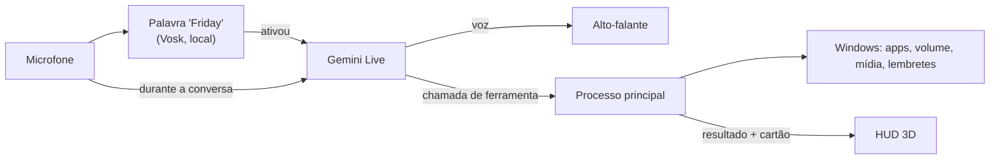

<div align="center">

# F.R.I.D.A.Y

**Assistente pessoal para Windows controlada 100% por voz, com HUD holográfico em 3D.**

*by Harle*

</div>

---

A FRIDAY fica discreta no canto da tela. Quando você diz **"Friday"**, o HUD se expande, ela ouve o pedido, age no seu PC e responde falando. Sem botões, sem janelas para clicar.

> **Status:** v0.1, em desenvolvimento ativo.

## O que ela faz

- **Conversa por voz em tempo real** com o Gemini Live: você pode interromper enquanto ela fala, como numa conversa normal.
- **Controla o PC:** abre e fecha programas, mexe no volume, controla músicas e vídeos, pesquisa na web e abre sites.
- **Lembretes** que ficam salvos e avisam na hora certa, mesmo depois de reiniciar o PC.
- **Status do sistema:** uso de CPU, RAM e placa de vídeo (NVIDIA).
- **Rotinas por voz, timers, lembretes repetidos, clima, modo foco e autodiagnóstico.**
- **Arquivos nas pastas pessoais:** listar, abrir, mover, renomear, criar pasta, mandar para a Lixeira e desfazer. Nunca sai das pastas pessoais, nunca sobrescreve e nunca abre programas ou scripts.
- **Saudação ao abrir** com o clima e os lembretes do dia, no máximo uma vez a cada 4 horas.
- **Cartões contextuais:** cada resposta mostra só o que importa (um medidor, um lembrete, o volume) e some sozinha.
- **Confirmação por voz** antes de ações perigosas, como fechar um programa.
- **Sons de interface** para você saber o que ela está fazendo mesmo sem olhar para a tela.
- **Estados visuais** para cada situação: ouvindo, pensando, falando, silenciada, sem conexão e sem microfone.

## O núcleo

O "rosto" da FRIDAY é um holograma de 9 mil partículas no formato de uma fita de Möbius, projetado de uma base com grade polar, feito com Three.js e shaders próprios. A fita reage ao nível real do áudio: ondula com a sua voz quando ela ouve, solta ondas de sonar quando fala e se transforma num nó toroidal quando está pensando.

Para não pesar nos jogos, o núcleo roda a 30 fps com o HUD aberto, cai para 15 fps parado no canto e pausa quando não está visível.

## Como funciona



- **Privacidade:** a palavra "Friday" é reconhecida no seu próprio PC. Nenhum áudio sai do computador antes disso.
- **Segurança:** a IA não roda comandos livres. Ela só escolhe ferramentas conhecidas, e os programas que ela pode abrir ficam numa lista que você controla (`apps.json`).
- **Latência:** o áudio dos instantes antes e durante a ativação é guardado e enviado assim que a conexão abre, então você pode falar "Friday, abre o Spotify" de uma vez só. O painel de sistema mostra a latência real de cada resposta.

## Instalação

Requisitos: Windows 10 ou 11, [Node.js](https://nodejs.org) 20 ou mais novo e um microfone.

**Jeito mais fácil:** baixe o [`instalar.bat`](instalar.bat) e dê dois cliques. Ele instala o que faltar, baixa o projeto, pede a sua chave do Gemini e já abre a FRIDAY.

**Passo a passo manual:**

```bash
git clone https://github.com/Harlezinhuu/F.R.I.D.A.Y.-by-Harle.git
cd F.R.I.D.A.Y.-by-Harle
npm install
npm run modelo        # baixa o reconhecedor da palavra "Friday" (~40 MB)
copy .env.example .env
```

Abra o `.env` e coloque sua chave do Gemini (grátis em [aistudio.google.com/apikey](https://aistudio.google.com/apikey)). Depois:

```bash
npm run dev           # roda em modo de desenvolvimento
npm run dist          # gera o instalador para Windows
npm test              # testes automáticos da lógica (lembretes, caminhos, rotinas, fala)
```

## Usando

Diga **"Friday"** e faça o pedido. Alguns exemplos:

| Você diz | Ela faz |
|---|---|
| "Friday, abre o Spotify" | Abre o programa e mostra o cartão |
| "Coloca o volume em 30" | Ajusta o volume do Windows |
| "Pula essa música" | Avança a faixa no player que estiver tocando |
| "Como tá a GPU?" | Mostra o uso de GPU, CPU e RAM |
| "Me lembra de mandar o relatório amanhã às nove" | Cria o lembrete |
| "Mostra o sistema completo" | Abre os painéis laterais |
| "Fecha o Discord" | Pede confirmação antes de fechar |
| "Pode descansar" | Encerra a conversa e volta para o canto |
| "Todo dia às 8 me lembra de tomar água" | Lembrete repetido (todo dia, dias úteis, semanal ou mensal) |
| "Timer de 10 minutos para o macarrão" | Liga um timer e avisa falando |
| "Cria a rotina modo trabalho: abre o Chrome, abre o Spotify e diz bom trabalho" | Salva a rotina; depois é só dizer "modo trabalho" |
| "Tira um print" | Salva em Imagens/FRIDAY, sem o HUD aparecer |
| "O que tem nos meus downloads?" | Lista os arquivos mais recentes |
| "Move o contrato.pdf para documentos/contratos" | Move (nunca sobrescreve) e dá para desfazer |
| "Como está o tempo?" | Clima agora e do dia |
| "Modo foco de 50 minutos" | Timer no núcleo e lembretes guardados até o fim |
| "Como você está?" | Autodiagnóstico: microfone, ativação, cérebro, voz, internet e rapidez |

**Atalho de emergência:** `Ctrl + Alt + Espaço` silencia a FRIDAY na hora, de qualquer lugar. Aperte de novo para ela voltar a ouvir. O ícone na bandeja do Windows tem a opção **Sair**.

### Escolhendo a voz

Por padrão, a FRIDAY fala com a voz nativa do Gemini, que é a mais rápida. Para usar uma voz do [Fish Audio](https://fish.audio), coloque no `.env`:

```env
FRIDAY_VOZ_PROVEDOR=fish
FISH_API_KEY=sua_chave
FISH_VOZ_ID=id_da_voz
```

Nesse modo, o texto da resposta é cortado em frases e cada frase vira áudio assim que fica pronta, então ela começa a falar antes de terminar de pensar a resposta inteira. Em qualquer voz, `FRIDAY_EFEITO_VOZ=1` aplica uma camada de "voz de IA": presença, brilho digital, compressão de rádio e uma sala curta.

### Adicionando programas

Pelo ícone na bandeja, escolha **Editar programas permitidos**. Cada programa tem um nome, apelidos (como você fala) e o alvo que o Windows abre:

```json
{ "nome": "Valorant", "apelidos": ["valorant", "valo"], "alvo": "C:\\Riot Games\\Riot Client\\RiotClientServices.exe", "processo": "VALORANT.exe" }
```

Use `"processo": null` para programas que a FRIDAY pode abrir mas nunca fechar.

## Estrutura

```
src/
  main/        processo principal: janela sobreposta, bandeja, atalho e ferramentas do Windows
  preload/     ponte segura entre o HUD e o processo principal
  renderer/    HUD: núcleo 3D, cartões, sons, microfone, Gemini Live e palavra de ativação
  shared/      tipos e a lista de ferramentas que a IA pode usar
scripts/       download do modelo de ativação
```

## Próximos passos

- [ ] Modo jogo: detectar jogos em tela cheia e ficar só no modo compacto
- [ ] Núcleo reagindo por faixas de frequência (graves, médios e agudos)
- [ ] Controle por gestos com a câmera
- [ ] Palavra de ativação treinada com sotaque brasileiro

## Licença e autoria

© 2026 Ahmad Mourad (**Harle**). **Todos os direitos reservados.**

Este repositório é público só para visualização e portfólio. Não é permitido copiar, modificar, redistribuir ou apresentar este código como seu sem autorização por escrito. Veja o arquivo [LICENSE](LICENSE). Para pedir permissão, fale comigo pelo LinkedIn.

---

<div align="center">Feito por <b>Harle</b> · <a href="https://www.linkedin.com/in/ahmad-mourad-bb0960300/">LinkedIn</a></div>
