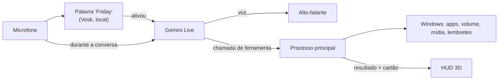

<div align="center">

# F.R.I.D.A.Y

**Assistente pessoal para Windows controlada 100% por voz, com HUD holográfico em 3D.**

*by Harle*

</div>

---

A FRIDAY fica discreta no canto da tela. Quando você diz **"Friday"**, o HUD se expande, ela ouve o pedido, age no seu PC e responde falando. Sem botões, sem janelas para clicar.

> **Status:** v0.1, em desenvolvimento ativo.

## O que ela faz

- **Conversa por voz em tempo real** com o Gemini Live: você pode interromper enquanto ela fala, como numa conversa normal.
- **Controla o PC:** abre e fecha programas, mexe no volume, controla músicas e vídeos, pesquisa na web e abre sites.
- **Lembretes** que ficam salvos e avisam na hora certa, mesmo depois de reiniciar o PC.
- **Status do sistema:** uso de CPU, RAM e placa de vídeo (NVIDIA).
- **Rotinas por voz, timers, lembretes repetidos, clima, modo foco e autodiagnóstico.**
- **Arquivos nas pastas pessoais:** listar, abrir, mover, renomear, criar pasta, mandar para a Lixeira e desfazer. Nunca sai das pastas pessoais, nunca sobrescreve e nunca abre programas ou scripts.
- **Memória que aprende** com as conversas, **cenas** da Wikipédia na tela e **tarefas de programação** com o Claude Code em segundo plano.
- **Modo explicação:** quando você pede uma explicação ou uma história, as palavras-chave aparecem gigantes, montadas em partículas, no instante em que ela as fala, com fotos, fatos e um carimbo de veredito.
- **Projeção 3D:** as partículas saem da fita e montam o objeto em holograma, como na cena da máquina do tempo. Formas da ciência, funções matemáticas, moléculas, proteínas, 257 modelos da NASA, STLs da Wikimedia, os seus arquivos e a IA para o resto.
- **Reconhecimento facial (opcional):** ela vê quem chamou e trata cada um pelo nome; visitantes não mexem em arquivos, memória nem desligam o PC. Tudo no próprio PC.
- **Segundo cérebro:** ela lê os seus documentos, anotações, PDFs, Word, PowerPoint, planilhas e projetos, guarda um índice só no seu PC e acha as coisas pelo assunto: "onde está aquele PDF de redes que fala de sub-rede?".
- **Pesquisa profunda:** "pesquisa a fundo os melhores cursos de Node e me entrega amanhã cedo". Ela planeja, pesquisa cada parte na internet, olha o que você já tem nos seus arquivos e entrega um relatório com fontes numeradas, falando o resumo na hora marcada.
- **Cérebro reserva:** se a internet cair (ou o Gemini não responder), ela continua funcionando para o básico, toda no PC: entende português sem internet, pensa com uma IA local (Ollama) e fala com a voz do Windows.
- **Guardiã da rede de casa:** avisa quando um aparelho desconhecido entra no seu Wi-Fi, diz quem está conectado e quanto da internet a casa e o PC estão usando agora.
- **Central do quarto:** um celular antigo na tomada vira o "Echo Dot" da FRIDAY: ouve "Friday" sozinho (sem mandar nada para a internet antes disso), acende a tela, conversa e volta a dormir. Enquanto ele está no ar, o PC fica só nas mãos. E ele é o porteiro que liga o PC quando você pede da rua.
- **Uma FRIDAY só no PC e no celular:** pareados, os avisos do celular saem no PC quando você está nele, o celular manda no PC (e liga o PC pela rede), a memória e a conversa continuam de um no outro, e os hologramas passam de uma tela para a outra.
- **Consultas pelo WhatsApp:** "marca um ortopedista semana que vem à tarde" e ela conversa com o robô (ou a atendente) do plano de saúde ou da clínica, em segundo plano, no PC e no celular. Antes de escolher horário, confirmar ou passar um dado que você não liberou, ela para e te pergunta. Marcado, vai para a agenda.
- **Visão de Deus:** um globo 3D com aviões, satélites, navios, terremotos, câmeras públicas e radar de chuva ao vivo, aberto e controlado por voz.
- **Clima de qualquer lugar do mundo** (cidade, bairro, região, estado, país ou ponto turístico), agora e até 16 dias, e **busca na internet** pelo Google para notícias, jogos, preços e qualquer fato atual.
- **Saudação ao abrir** com o clima e os lembretes do dia, no máximo uma vez a cada 4 horas.
- **Cartões contextuais:** cada resposta mostra só o que importa (um medidor, um lembrete, o volume) e some sozinha.
- **Confirmação por voz** antes de ações perigosas, como fechar um programa.
- **Sons de interface** para você saber o que ela está fazendo mesmo sem olhar para a tela.
- **Estados visuais** para cada situação: ouvindo, pensando, falando, silenciada, sem conexão e sem microfone.

## O núcleo

O "rosto" da FRIDAY é um holograma de 9 mil partículas no formato de uma fita de Möbius, projetado de uma base com grade polar, feito com Three.js e shaders próprios. A fita reage ao nível real do áudio: ondula com a sua voz quando ela ouve, solta ondas de sonar quando fala e se transforma num nó toroidal quando está pensando.

Para não pesar nos jogos, o núcleo roda a 30 fps com o HUD aberto, cai para 15 fps parado no canto e pausa quando não está visível.

## Como funciona



- **Privacidade:** a palavra "Friday" é reconhecida no seu próprio PC. Nenhum áudio sai do computador antes disso.
- **Segurança:** a IA não roda comandos livres. Ela só escolhe ferramentas conhecidas, e os programas que ela pode abrir ficam numa lista que você controla (`apps.json`).
- **Latência:** o áudio dos instantes antes e durante a ativação é guardado e enviado assim que a conexão abre, então você pode falar "Friday, abre o Spotify" de uma vez só. O painel de sistema mostra a latência real de cada resposta.

## Instalação

Requisitos: Windows 10 ou 11, [Node.js](https://nodejs.org) 20 ou mais novo e um microfone.

**Jeito mais fácil:** baixe o [`instalar.bat`](instalar.bat) e dê dois cliques. Ele instala o que faltar, baixa o projeto, pede a sua chave do Gemini, monta a FRIDAY, cria o atalho **F.R.I.D.A.Y** no Menu Iniciar e já abre. A partir daí ela **abre sozinha quando o Windows liga** (sem janela de terminal). Para desligar isso, use o ícone da bandeja › *Iniciar com o Windows*. Para pegar as novidades, ícone da bandeja › *Atualizar a FRIDAY* (ou dois cliques no `atualizar.bat`).

**Passo a passo manual:**

```bash
git clone https://github.com/Harlezinhuu/F.R.I.D.A.Y.-by-Harle.git
cd F.R.I.D.A.Y.-by-Harle
npm install
npm run modelo        # baixa o reconhecedor da palavra "Friday" (~40 MB)
copy .env.example .env
```

Abra o `.env` e coloque sua chave do Gemini (grátis em [aistudio.google.com/apikey](https://aistudio.google.com/apikey)). Depois:

```bash
npm run dev           # roda em modo de desenvolvimento
npm run dist          # gera o instalador para Windows
npm test              # testes automáticos da lógica (lembretes, caminhos, rotinas, fala, memória, tarefas)
```

## Usando

Diga **"Friday"** e faça o pedido. Alguns exemplos:

| Você diz | Ela faz |
|---|---|
| "Friday, abre o Spotify" | Abre o programa e mostra o cartão |
| "Coloca o volume em 30" | Ajusta o volume do Windows |
| "Pula essa música" | Avança a faixa no player que estiver tocando |
| "Como tá a GPU?" | Mostra o uso de GPU, CPU e RAM |
| "Me lembra de mandar o relatório amanhã às nove" | Cria o lembrete |
| "Mostra o sistema completo" | Abre os painéis laterais |
| "Fecha o Discord" | Pede confirmação antes de fechar |
| "Pode descansar" | Encerra a conversa e volta para o canto |
| "Minimiza" / "volta pro canto" | Encolhe a FRIDAY na hora, como quando ela abre |
| "Todo dia às 8 me lembra de tomar água" | Lembrete repetido (todo dia, dias úteis, semanal ou mensal) |
| "Timer de 10 minutos para o macarrão" | Liga um timer e avisa falando |
| "Cria a rotina modo trabalho: abre o Chrome, abre o Spotify e diz bom trabalho" | Salva a rotina; depois é só dizer "modo trabalho" |
| "Tira um print" | Salva em Imagens/FRIDAY, sem o HUD aparecer |
| "O que tem nos meus downloads?" | Lista os arquivos mais recentes |
| "Move o contrato.pdf para documentos/contratos" | Move (nunca sobrescreve) e dá para desfazer |
| "Como está o tempo?" | Clima agora e do dia |
| "Modo foco de 50 minutos" | Timer no núcleo e lembretes guardados até o fim |
| "Como você está?" | Autodiagnóstico: microfone, ativação, cérebro, voz, internet e rapidez |
| "Eu gosto de café sem açúcar" | Ela aprende em silêncio e lembra nas próximas conversas |
| "O que você sabe sobre mim?" / "Esquece isso" / "Para de aprender" | Mostra, apaga ou pausa a memória |
| "Me fala da Torre Eiffel" | Responde e mostra foto e resumo da Wikipédia na tela |
| "Tarefa no projeto site: criar a página de contato" | O Claude Code programa em segundo plano e ela avisa quando terminar |
| "Como está a tarefa?" | Diz o andamento e a branch do resultado |

**Atalho de emergência:** `Ctrl + Alt + Espaço` silencia a FRIDAY na hora, de qualquer lugar. Aperte de novo para ela voltar a ouvir. O ícone na bandeja do Windows tem a opção **Sair**.

### Escolhendo a voz

Por padrão, a FRIDAY fala com a voz nativa do Gemini, que é a mais rápida. Para usar uma voz do [Fish Audio](https://fish.audio), coloque no `.env`:

```env
FRIDAY_VOZ_PROVEDOR=fish
FISH_API_KEY=sua_chave
FISH_VOZ_ID=id_da_voz
```

Nesse modo, o texto da resposta é cortado em frases e cada frase vira áudio assim que fica pronta, então ela começa a falar antes de terminar de pensar a resposta inteira. Em qualquer voz, `FRIDAY_EFEITO_VOZ=1` aplica uma camada de "voz de IA": presença, brilho digital, compressão de rádio e uma sala curta.

### Tarefas de programação

A FRIDAY entrega a tarefa ao [Claude Code](https://www.npmjs.com/package/@anthropic-ai/claude-code), que precisa estar instalado e com login feito no PC. Cada tarefa roda numa cópia isolada do projeto (`git worktree`) e o resultado fica numa branch `friday/tarefa-N-...` para você revisar: sem push e sem merge. O Claude Code só lê e edita arquivos; comandos de terminal, só os que você liberar.

Os projetos ficam em **Editar projetos de programação**, no ícone da bandeja:

```json
[
  { "nome": "Site", "pasta": "C:\\Users\\Harle\\Projetos\\site", "comandos": ["npm test", "npm run build"] }
]
```

### Dupla de programação por voz

Com o projeto aberto no VS Code (ela sabe qual é pelo título da janela), ou dizendo o nome dele:

- **"Roda os testes."** Ela roda o comando de teste liberado no `projetos.json` e diz qual teste quebrou, em que linha e o motivo provável, olhando o código em volta. Entende node:test, Jest, Vitest, pytest e os erros do TypeScript. Se demorar, ela avisa quando terminar.
- **"Posso dar push?"** A revisora olha o que ainda não foi para o GitHub: chave de API, senha, `.env`, marca de conflito de merge, `console.log` e `debugger` esquecidos. Com "revisão geral", ela também comenta o código. **"Instala a revisora"** coloca um gancho no git que bloqueia sozinho o push que levar chave ou `.env`.
- **"Explica esse código"** (ou "explica a função tocarMusica"): ela lê o arquivo aberto e explica parte por parte.
- **"Anota um bug no Harle Bot: a fila trava quando está vazia."** Ela confirma e cria a issue no GitHub (com o [GitHub CLI](https://cli.github.com) logado) ou abre a página da issue já preenchida. Depois, "resolve a issue 12" vira uma tarefa de programação com o texto da issue.

Só roda os comandos liberados no projeto, e arquivos com chaves nunca são lidos para a IA.

### Cérebro reserva (sem internet)

Se você chamar a FRIDAY e não tiver internet (ou o Gemini não responder), ela entra no **modo reserva**, tudo no seu PC:

- **Ouve** em português com o Vosk, sem internet: o `npm run modelo` baixa esse ouvido (uns 31 MB) junto com os outros modelos.
- **Pensa** com uma IA local pelo [Ollama](https://ollama.com), se estiver instalado. Instale o Ollama e rode uma vez `ollama pull qwen2.5:3b` (uns 2 GB; roda bem numa placa de 6 GB). Para usar outro modelo: `FRIDAY_RESERVA_MODELO` no `.env`.
- **Sem o Ollama**, ela entende os pedidos do dia a dia por regras: abrir e fechar programas, volume, música, lembretes, timers, que horas são, status do PC, bloquear o PC e procurar nos seus arquivos.
- **Fala** com a voz do Windows (instale a voz em português em Configurações › Hora e idioma › Fala, se não tiver).

Clima, notícias, pesquisa e WhatsApp precisam de internet; ela avisa isso em uma frase. Quando a internet volta, a próxima conversa já é com o Gemini.

### Guardiã da rede de casa

A cada 10 minutos ela olha quais aparelhos estão no seu Wi-Fi (pela tabela ARP do Windows, o que qualquer aparelho da rede já enxerga). Na primeira vez, só aprende quem já está em casa; depois, se aparecer um desconhecido, ela avisa no PC (e no celular, se você não estiver no PC): "Um aparelho que eu não conhecia entrou no seu Wi-Fi: Xiaomi, no endereço 192.168.0.37".

- **"Quem está no meu Wi-Fi?"** Lista os aparelhos ligados, com o nome que você deu, o nome na rede ou o fabricante (pela lista oficial da IEEE, baixada uma vez).
- **"O 37 é o celular da minha mãe."** Ela passa a chamar o aparelho assim.
- **"Quem está gastando a internet?"** Ela mede quanto a casa toda está usando (pelo roteador, se ele informar via UPnP) e quanto disso é o PC. Por aparelho, só o próprio roteador sabe.

Celulares modernos usam um endereço "privado" por rede; ela reconhece isso e chama de "celular ou computador (endereço privado)". Para desligar: `FRIDAY_REDE=0` no `.env`.

### Ela usa o Windows por você

Com um programa na frente, peça o que fazer dentro dele: "no Spotify, coloca a playlist de estudo", "preenche esse formulário com meu nome", "no Bloco de Notas, escreve a lista de compras e salva". Ela lê a janela pelo UI Automation do Windows (botões, campos e textos, numerados), vê uma foto da tela (sem o HUD na frente) e vai passo a passo: clica, escreve, aperta teclas e rola, conferindo a janela depois de cada passo.

Os limites ficam no código, não só na instrução:

- **Só nos programas da sua lista** (os de **Editar programas permitidos** que têm `processo`). Terminal, PowerShell, Registro, Gerenciador de Tarefas, cofres de senha, acesso remoto e telas de segurança do Windows: nunca, nem se estiverem na lista.
- **No navegador, banco, pagamento, compra e login ficam com você:** se o título da aba parecer de banco, Pix, checkout, fatura ou "entrar", ela não mexe.
- **Senha, nunca:** campos de senha aparecem marcados e ela recusa clicar ou escrever neles.
- **Botões de pagar, comprar, enviar, apagar ou confirmar** pedem a sua confirmação antes, como no celular.
- **Teclas só de uma lista** (Enter, Tab, setas, Ctrl+S, Ctrl+T e outras); nada de Alt+F4, Win+R ou Delete.
- **No máximo 15 passos seguidos:** depois ela pergunta se pode continuar.

### HUD em realidade aumentada

No app do celular, em **Ajustes › FRIDAY do PC › Ver o PC pela câmera** (ou falando: "mostra o HUD do PC"), aponte a câmera para o monitor. O PC mostra quatro marcas nos cantos da tela (o desenho dos cantos do QR Code) e o celular acha as marcas em cada quadro, monta a perspectiva e "cola" os painéis no plano do monitor:

- **Em cima:** a hora, o nome do PC, há quanto tempo está ligado, o programa na frente e quantos aparelhos estão no Wi-Fi.
- **Sistema:** CPU, RAM, GPU e memória de vídeo (vermelho acima de 85%).
- **Hoje:** os lembretes que faltam no dia.
- **Em andamento:** tarefa de programação, pesquisa profunda, consulta sendo marcada e aparelho desconhecido no Wi-Fi.

Com o celular deitado, os painéis ficam dos lados do monitor; em pé, em cima e embaixo. Se uma marca ficar tapada, ela completa a quarta pelas outras três. A imagem da câmera não sai do celular; as marcas somem sozinhas uns segundos depois que você fecha.

### Memória

O que ela aprende fica só no seu PC (`memoria.json`, na pasta de configuração). Senhas, PINs, chaves, documentos e números de cartão ou conta são recusados antes de gravar.

### Modo explicação

Peça uma explicação, uma história, uma teoria ou "o que você faria" ("Friday, me explica como o Watergate foi descoberto"). A fita vira emissor no canto, um rio de partículas corre até um ponto de fuga cercado de linhas de radar e cada palavra-chave é montada em pontos, em perspectiva, **no momento em que a voz dela chega nela**; de uma palavra para a outra, as partículas voam e se rearrumam. Palavras de perigo, proibição ou mentira ficam vermelhas.

Ao lado entram fotos da Wikipédia (quando ela cita o assunto) e cartões com fatos curtos; à esquerda fica a trilha das palavras já ditas. Quando a explicação responde se algo é verdade, um carimbo cai no fim: **FALSO**, **MITO**, **VERDADE**... Uns segundos depois que ela termina, ou quando você volta a falar, tudo volta para a fita.

### Segundo cérebro

"Friday, onde está aquele PDF de redes que fala de sub-rede?", "o que eu anotei sobre o TCC?", "acha o contrato do aluguel". Ela responde com o arquivo e o trecho; "abre o primeiro" abre.

- **O que ela lê:** Documentos, Área de Trabalho, Downloads e os projetos de programação (`projetos.json`). Textos, anotações (.md), código, PDF, Word, PowerPoint, Excel e OpenDocument.
- **O que ela nunca lê:** `.env`, chaves, cofres de senha, `node_modules` e `.git`. Chaves de API que aparecerem no meio de um texto viram `[oculto]` antes de entrar no índice.
- **Onde fica:** o índice fica só no seu PC (`cerebro/indice.json` na pasta de configuração). Na hora da pergunta, só os trechos achados vão para o Gemini responder, nunca os arquivos inteiros.
- **Como acha pelo assunto:** a FRIDAY manda junto da sua pergunta palavras relacionadas (sinônimos, o termo em inglês), e a busca roda no PC.
- Ela lê devagar, em segundo plano, e depois só relê o que mudou. "Lê meus arquivos de novo" força agora; "quantos arquivos você já leu?" mostra como está.
- Para escolher outras pastas: `FRIDAY_CEREBRO_PASTAS` no `.env` (separadas por `;`). Para desligar: `FRIDAY_CEREBRO=0`.

### Pesquisa profunda

"Friday, pesquisa a fundo os melhores cursos de Node e me entrega amanhã cedo." Ela trabalha sozinha, em segundo plano:

1. Quebra o tema em 4 a 6 perguntas.
2. Pesquisa cada uma na internet (Google, pelo Gemini), anotando de onde veio cada coisa.
3. Olha no segundo cérebro o que você já tem guardado sobre o assunto.
4. Escreve o relatório: resumo, o que encontrou (com as fontes numeradas [1], [2]), o que os seus arquivos já diziam, onde as fontes discordam e próximos passos.

O relatório fica em **Documentos › FRIDAY › Pesquisas** (página para ler e Markdown). Quando fica pronto (ou na hora que você pediu), ela fala o resumo no PC, mostra uma notificação e manda para o celular pareado. "Como está a pesquisa?", "abre a pesquisa de Node" e "me conta a pesquisa de novo" também funcionam. Leva uns 3 a 5 minutos, porque ela vai devagar para respeitar o limite da chave grátis do Gemini.

### Projeção 3D

Diga "Friday, projeta..." e as partículas saem da fita de Möbius, que encolhe e vira o emissor na base, para montar o objeto com o wireframe por cima.

| Peça | Exemplo |
|---|---|
| Formas da ciência | "projeta a fita de Möbius invertida", "um tesseract", "o sistema solar" (posições reais de hoje), "o atrator de Lorenz", "um buraco negro", "DNA", "átomo", "garrafa de Klein", "galáxia" |
| Funções | "projeta z igual seno de x vezes cosseno de y"; com t ela se mexe: "seno de x menos t" |
| Moléculas e proteínas | "projeta a molécula da cafeína" (PubChem), "a hemoglobina" (RCSB PDB) |
| NASA | "projeta a estação espacial", "o Hubble", "o Saturn V", "o Perseverance": 257 modelos de domínio público |
| Wikimedia | STLs abertos da Wikimedia Commons, com autor e licença na ficha |
| Seus designs | importe os seus modelos (veja abaixo) e peça pelo nome ou apelido: "projeta o reator" |
| Qualquer outra coisa | a IA monta o objeto com peças simples e nomeadas |

Com o holograma na tela: **gira**, **para**, **vira para a esquerda/direita**, **vira de cabeça para baixo**, **vista de cima/de lado/de frente**, **aproxima/afasta**, **explode** (as peças se separam com etiquetas) e **junta**, **inverte** (como no filme, fica laranja), **corta** (corte transversal que varre o objeto), **renderiza** (ganha superfície: "Modelo renderizado"), **só as linhas**, **mede**, **salva** (vai para Imagens/FRIDAY) e **fecha**.

A projeção fica na tela mesmo quando a conversa acaba; diga "Friday, fecha a projeção" ou "minimiza".

#### Importando os seus designs

Diga **"Friday, importa um design"** (ou ícone da bandeja → *Importar designs…*) e escolha os arquivos: modelos `.glb`, `.gltf`, `.stl` e `.obj`, ou um pacote `.zip` com o modelo, o `.bin` e as texturas. A FRIDAY faz uma cópia em **Documentos/FRIDAY Modelos** (o original fica onde estava), dá um nome tirado do arquivo e pergunta como você quer chamar: "chama esse de reator, ou núcleo". Depois é só "projeta o reator".

- **"Quais designs eu tenho?"** lista os nomes e apelidos.
- **"Remove o reator"** tira da biblioteca e apaga a cópia (ela confirma antes).
- Num `.gltf`, o `.bin` e as texturas vão embutidos na projeção; num `.zip`, ela acha o modelo principal sozinha e não deixa o pacote escrever fora da pasta.
- A lista fica em `designs.json`, na mesma pasta, e dá para editar à mão. Arquivos soltos na pasta também funcionam, pelo nome do arquivo.

A FRIDAY já vem com seis designs originais, desenhados peça por peça para ela (`npm run designs` gera de novo): o **núcleo da FRIDAY**, a **oficina do Harle** (a mesa, o PC, os monitores e a estante), a **turbina Harle**, o **toca-discos do Harle Player**, o **Harle Bot** e o **drone Falcão**. Eles entram na biblioteca sozinhos na primeira vez; se você remover um, ele não volta.

Fora esses, a FRIDAY não vem com design de ninguém e não sai procurando: só entra o que você importar. Os arquivos ficam no seu PC, fora do repositório; usar ou publicar designs de terceiros fica por sua conta e pela licença de cada um.

#### Mexendo com as mãos

Diga "Friday, liga os gestos" (ou "quero mexer com as mãos"). A webcam liga, uma prévia aparece no canto e a imagem é processada só no seu PC pelo MediaPipe: nada de vídeo vai para a internet. A câmera desliga sozinha depois de um minuto e meio sem ver mãos, ou quando você diz "desliga os gestos".

| Gesto | O que faz |
|---|---|
| Mão fechada e mover | segura e gira o holograma |
| Pinça (polegar + indicador) subindo / descendo | aproxima / afasta |
| Duas mãos fechadas se afastando / aproximando | aumenta / diminui |
| Abrir as duas mãos abertas para os lados | explode as peças |
| Juntar as duas mãos abertas | monta de novo |
| Apontar com o indicador e parar em cima de uma peça | seleciona a peça (ela brilha e as outras apagam) |
| Tapa rápido com a mão aberta | joga o holograma para fora (fecha) |

Os modelos compactados com Draco (como os da NASA) são abertos pelo decodificador do próprio three.js, que vai junto com a FRIDAY e funciona offline.

### Mesa holográfica

Diga **"Friday, abre a mesa"**. O HUD vira uma mesa de luz em perspectiva, com o arquivo dos seus cartões: os projetos do `projetos.json`, os designs importados e os relatórios da pesquisa profunda.

- **Passar os cartões:** deslize a mão aberta para o lado (com os gestos ligados) ou diga "passa" / "volta um".
- **Abrir:** toque duplo no ar (feche a pinça duas vezes rápido) ou "abre esse". Também direto: "mostra o prédio do Harle Bot", "coloca a turbina na mesa".
- **Projeto vira prédio:** cada pasta é um andar (o térreo são os arquivos da raiz; uma pasta que tem quase tudo, como o `src`, é aberta em subpastas) e cada arquivo é uma sala, do tamanho do código que tem. Sala **vermelha** é onde os testes quebraram na última vez que rodaram; **âmbar** é arquivo mexido que ainda não foi para o GitHub. Ela comenta o que aparece.
- **Design vira holograma** em cima do emissor da mesa, girando. Abra as duas mãos para explodir as peças (com os nomes) e junte para montar.
- **A FRIDAY em miniatura:** uma figura de luz, sem rosto, com a fita de Möbius girando na cintura, anda pela mesa até o que está aberto e aponta para ele quando ela fala.
- Mão fechada gira a vista; "volta" retorna aos cartões; "fecha a mesa" fecha.

### Visão de Deus

Diga "Friday, visão de Deus em Tóquio com os aviões" ou "mostra os terremotos no Japão em visão noturna". A FRIDAY abre o globo numa janela própria, já no lugar, nas camadas e no estilo pedidos. "Agora mostra Paris" troca só o lugar. "Fecha a visão de Deus" fecha a janela e desliga o servidor.

Na primeira vez, ela baixa e instala o projeto sozinha na pasta `extras` (leva alguns minutos) e abre quando terminar. Precisa do **Node 24.14 ou mais novo (fora o 25), ou do Node 26**, e do Git. Não precisa de chave nenhuma: o mapa usa a imagem de satélite da Esri.

Camadas: aviões, aviões militares, satélites, navios, terremotos, câmeras públicas, foguetes, radar de chuva, raios, ciclones, vento e trânsito. Estilos: normal, noturno, térmico, retrô, anime, noir e neve.

Só dados públicos de lugares, veículos e eventos. A FRIDAY não localiza nem rastreia pessoas.

O globo é o [God's Eye View](https://github.com/bilawalsidhu/gods-eye-view), de Bilawal Sidhu, sob licença MIT. Ele não faz parte deste repositório: é baixado do projeto original na primeira vez que você pede.

### Adicionando programas

Pelo ícone na bandeja, escolha **Editar programas permitidos**. Cada programa tem um nome, apelidos (como você fala) e o alvo que o Windows abre:

```json
{ "nome": "Valorant", "apelidos": ["valorant", "valo"], "alvo": "C:\\Riot Games\\Riot Client\\RiotClientServices.exe", "processo": "VALORANT.exe" }
```

Use `"processo": null` para programas que a FRIDAY pode abrir mas nunca fechar.

## FRIDAY no celular (Android)

Um app de assistente pessoal, como o do ChatGPT, com a voz e a personalidade da FRIDAY e um visual próprio, a direção **Órbita**: um mundo 3D só, com a fita de Möbius iridescente atrás de todas as telas, mudando de papel em cada uma (grande na voz, auréola no chat, vista de cima nas conversas), reagindo à voz e acompanhando a inclinação do celular.

- **Voz:** toque no botão e converse em tempo real (Gemini Live), com o núcleo de Möbius reagindo.
- **Chat:** respostas que chegam aos pedaços, com markdown, e histórico de conversas (as de voz também ficam salvas como texto).
- **Lembretes e timers** viram notificações do Android; **clima**, **pesquisa**, **memória** e **projeção 3D** (arraste para girar, pince para aproximar).
- **Controle do celular** por voz ou chat: abrir apps, lanterna, volume, tocar/pausar música, alarmes, brilho, Não perturbe, rotas no Maps, bateria, ligações, SMS e WhatsApp, agenda e contatos.
- **Oficina de hologramas:** "abre a oficina" (ou Ajustes › Oficina de hologramas). A câmera de trás mostra o quarto e o design aparece na sua frente, parado no lugar quando você vira o celular. Com a mão livre: **apontar e segurar** em cima de uma peça seleciona (ela fica laranja), a **pinça** pega e arrasta (a peça ou, no vazio, o modelo inteiro), a **mão fechada** gira, um **tapa** joga a peça fora e **duas pinças rápidas** selecionam o que está debaixo do dedo. Nos botões ou pela voz: duplicar, aumentar, diminuir, pintar ("pinta de dourado"), voltar ao original, explodir, desfazer, refazer e **salvar como versão nova** ("salva como drone v2"), que fica no celular e, pareado, entra na biblioteca do PC. Sem o reconhecimento de mãos, o toque funciona: um dedo gira, dois dedos mudam o tamanho, tocar seleciona. A imagem da câmera não sai do celular.
- **Mesa holográfica no celular:** "abre a mesa" (ou o botão **Mesa** da oficina). A mesma mesa do PC aparece pequena, uns 45 cm, em cima do seu móvel pela câmera, com a FRIDAY em miniatura andando nela. Os cartões são os designs do celular e, com o PC pareado e ligado, os projetos, relatórios e designs de lá. Um tapa de lado passa os cartões (ou deslize o dedo); duas pinças rápidas abrem (ou toque no cartão da frente). Design abre no editor, em cima do emissor; projeto vira o prédio, que o PC monta e manda; relatório abre no PC. "Volta" retorna aos cartões.
- **Mexer dentro dos apps:** com o controle da tela ativo (Acessibilidade), ela lê a tela e toca, escreve e rola em qualquer app ("abre o Spotify e procura Daft Punk").
- **Avisos por voz:** quando chega uma ligação, ela fala "Senhor, a Mãe está te ligando" (com a voz dela, pelo TTS do Gemini, mesmo com o app fechado); mensagens dos **contatos importantes** no WhatsApp, SMS, Telegram e outros também são avisadas, e ela pode ler o texto se você quiser. Fica quieta no modo silencioso e durante ligações; no Não perturbe, só avisa dos importantes. Diga "a Mãe é importante" ou adicione em Ajustes › Avisos por voz.
- **Assistente padrão:** segure o botão de ligar (ou de início) e a FRIDAY abre já ouvindo. Enquanto ela ouve, uma notificação fixa mantém o microfone quando ela abre outro app, com o botão **Encerrar**.

**Limites de segurança no celular:** ligações, mensagens e botões de pagar, comprar, enviar ou apagar só acontecem depois que você diz "confirma"; ela nunca digita em campos de senha; e não lê nem toca em apps de banco, pagamento, instalação de apps ou permissões.

**Para liberar tudo:** em Ajustes › Controle do celular, toque em **Liberar** (contatos, ligações, SMS e agenda), **Ativar** (controle da tela) e **Definir** (assistente padrão); em Ajustes › Avisos por voz, **Ativar** (acesso às notificações). Como o APK não vem da Play Store, o Android 13+ pode chamar o controle da tela e o acesso às notificações de "configuração restrita": abra *Informações do app* › ⋮ › *Permitir configurações restritas* e ative de novo.

O APK é gerado pelo GitHub Actions (`.github/workflows/celular.yml`) a cada mudança no app e publicado em **Releases**: baixe pelo celular e instale. A chave do Gemini é colada nos Ajustes do app e fica só no celular. O código fica em `mobile/` e reaproveita o núcleo 3D, o áudio, o Gemini Live e a projeção da FRIDAY do PC.

Para atualizar o app sem desinstalar, o APK precisa ser sempre assinado com a mesma chave: ela fica nos segredos do repositório (`ANDROID_KEYSTORE_B64` e `ANDROID_KEYSTORE_SENHA`).

### Reconhecimento facial (opcional)

Vem desligado. Liga quando alguém diz **"Friday, cadastra meu rosto"**: ela explica o que vai guardar, pede o seu "sim", e você olha para a webcam por uns segundos. O primeiro cadastro é o **dono**; depois, com o dono por perto, dá para cadastrar a família ("cadastra o rosto da Ana") como **convidados**.

A cada "Friday", a webcam abre por uns 2 segundos, ela vê quem é e fecha a câmera:

| Quem chamou | O que muda |
|---|---|
| O dono | Tudo como sempre, com a memória dele |
| Um convidado | Ela chama pelo nome; não conta nada da memória do dono e não mexe em arquivos, memória, tarefas, desligar o PC nem pareamento |
| Alguém não reconhecido (ou uma foto na frente da câmera) | Visitante, com as mesmas limitações |

"Friday, só atende a mim" faz ela não conversar com mais ninguém ("atende todo mundo" desfaz). "Quem está cadastrado?", "apaga meu rosto" (cada um apaga o seu; apagar o dono apaga tudo e desliga o reconhecimento).

**Privacidade:** nenhuma foto é guardada. Fica só uma assinatura numérica do rosto (a "impressão digital" que o modelo tira), em `rostos.json` na pasta de configuração, **só neste PC**: não vai para a internet, para o Gemini nem para o celular. Rosto é dado biométrico (dado pessoal sensível na LGPD), por isso o cadastro só acontece com o consentimento de quem é cadastrado e pode ser apagado a qualquer momento. Os modelos são do [Human](https://github.com/vladmandic/human) (licença MIT) e rodam na placa de vídeo do seu PC. Se ela errar muito, ajuste `FRIDAY_ROSTO_LIMIAR` no `.env`.

## Uma FRIDAY só: PC e celular

Pareados, o PC e o celular viram a mesma assistente.

**Para parear:** no PC, diga "Friday, pareia o celular" (ou ícone da bandeja › *Parear celular*). Aparece um QR Code no HUD. No celular: Ajustes › FRIDAY do PC › Parear › **Ler o QR Code** (ou digite o código de 8 dígitos e o endereço que aparecem embaixo). Na primeira vez, o Windows pergunta se a FRIDAY pode usar a rede: libere em **redes privadas**.

| No dia a dia | Como |
|---|---|
| Ligação ou mensagem importante no celular enquanto você usa o PC | Quem avisa é o PC ("Senhor, a Mãe está te ligando"); o celular fica quieto. Longe do PC, o celular fala. |
| Mandar no PC pelo celular | "Abre o Spotify no PC", "bloqueia o PC", "desliga o PC" (confirma antes), "projeta o Saturn V no PC", "executa a rotina trabalho", "tarefa no projeto site: ..." |
| Ligar o PC pelo celular | "Liga o PC", mesmo com ele desligado. Em casa vai pelo Wi-Fi; fora de casa (no 4G, chegando), pela internet, depois de preparar uma vez (abaixo) |
| Continuar a conversa | O que você falou com ela no celular nos últimos 15 minutos entra no começo da conversa no PC, e o contrário também |
| Memória | Uma só: o que ela aprende num aparelho vale no outro, e o que você manda esquecer some dos dois |
| Hologramas | No celular, arraste a projeção para cima e ela se monta no PC. No PC, com o app do celular aberto, o tapa com a mão (ou "joga isso pro celular") manda a projeção para o celular |
| Links e textos | "Manda esse site pro celular", "manda esse texto pro celular" |

**Ligar o PC de fora de casa.** Com o PC ligado, diga uma vez: "Friday, prepara para ligar o PC de fora". Ela:
- ajusta a placa de rede para acordar com o "pacote mágico" e desliga a inicialização rápida do Windows (o Windows pede autorização);
- abre sozinha a porta UDP 40009 no roteador, pelo UPnP, apontando para o PC;
- confere se a operadora usa CGNAT (aí a internet de casa não recebe nada de fora e ela avisa);
- guarda o endereço de casa, que o celular pega sozinho quando fala com o PC.

Fica com você: na BIOS, ligar "Wake on LAN" (ou "Power On By PCI-E") e desligar o "ErP"; deixar o PC no **cabo de rede** (desligado, Wi-Fi quase nunca acorda). Se ele não ligar depois de alguns minutos desligado, ative no roteador o vínculo de IP e MAC para o IP do PC. Se a operadora trocar o IP de casa com frequência, crie um nome grátis no [DuckDNS](https://www.duckdns.org) e coloque `FRIDAY_DUCKDNS=nome:token` no `.env`: o PC mantém o nome em dia.

Tudo que passa entre os dois vai lacrado com AES-256-GCM, com a chave trocada no pareamento; cada mensagem tem hora e número único (não dá para repetir uma mensagem copiada da rede). Fora de casa, funciona pelo [Tailscale](https://tailscale.com) se os dois estiverem nele. "Desparear" no celular, ou parear de novo no PC, troca a chave.

**Também no celular:** câmera no modo de voz (o olho no canto: ela vê o que você mostra e responde "o que é isso?"), foto no chat, responder mensagens pela voz ("responde que já tô indo", sem abrir o WhatsApp), "quem me mandou mensagem?", resumo da manhã quando você desliga o alarme (clima, agenda, lembretes e quem mandou mensagem de noite), modo carro (no Bluetooth do carro ela lê todas as mensagens) e o modo explicação de partículas.

## Central do quarto (o seu Echo Dot)

Um celular que fica em casa, na tomada, vira a central do quarto. Testado para um Galaxy A51, serve qualquer Android 8 ou mais novo.

**Para ligar, no celular da central:**
1. Instale o app, coloque a chave do Gemini e **pareie com o PC** (Ajustes › FRIDAY do PC).
2. Ajustes › **Central do quarto** › marque "Este celular é a central". Na primeira vez ela baixa o ouvido da palavra "Friday" (uns 40 MB) e pede o microfone.
3. Toque em **Permitir** (abrir por cima) e **Liberar** (bateria sem restrição).
4. Tire a senha da tela de bloqueio desse celular (ele fica em casa) e, na Samsung, ligue Bateria › Proteger bateria.

**Como funciona:**
- Ela procura "Friday" **no próprio celular**, com supressão de ruído e cancelamento de eco. Nada sai do aparelho antes disso. Ouviu: acende a tela e já está conversando, e o que você disse logo depois do "Friday" ("Friday, que horas são?") vai junto.
- Se ela acordar por engano e você não falar nada, volta a dormir quieta em 7 segundos.
- Enquanto a central está no ar, o PC não ouve "Friday" (fica só nas mãos, recebendo as ordens dela). Se a central sair do ar, o PC volta a ouvir em até 75 segundos.
- "Friday, fica quieta" silencia a central por uma hora (ou o tempo que você disser); o botão da notificação faz o mesmo.
- Se o celular reiniciar, ela volta sozinha.
- **Sensibilidade:** "O que ela ouviu" mostra cada vez que ela ouviu a palavra e com que volume; se ela acordar demais ou de menos, mude entre Sensível, Normal e Exigente.

**Porteiro (ligar o PC da rua):** com a central pareada com o PC, diga "liga o PC" no seu celular de qualquer lugar. O pedido vai lacrado (a mesma chave do pareamento) por um serviço público de avisos, o [ntfy](https://ntfy.sh), até a central, que manda o sinal pela rede de casa e te avisa quando o PC ligar. Funciona com CGNAT e sem mexer no roteador. Precisa só do Wake-on-LAN na BIOS e do PC no cabo.

## Consultas pelo WhatsApp

A FRIDAY marca consultas e exames conversando com o WhatsApp do seu plano de saúde ou da clínica, sem custo: é o mesmo WhatsApp que você usa.

**1. Salve o lugar uma vez** (no PC e no celular, cada um guarda o seu):
> "Friday, salva o WhatsApp do São Cristóvão: 11 9xxxx-xxxx. Se pedirem, pode passar a carteirinha 1234567 e o meu nome completo, Fulano de Tal."

O número e os dados ficam só naquele aparelho (no PC, em `consultas.json` na pasta de configuração). Ela só passa o que você liberou ali ou disse na hora.

**2. Peça:**
> "Marca uma consulta com ortopedista na semana que vem, de tarde."

Ela diz com quem vai falar e o que vai pedir, e espera você confirmar. Depois conversa sozinha, em segundo plano: responde os menus do robô, pede a especialidade, a unidade e as datas. **Ela sempre para e te pergunta antes de:**
- escolher dia, horário, médico ou unidade;
- confirmar o agendamento;
- mandar um número ou dado que você não liberou (CPF, data de nascimento...).

E nunca passa dados de cartão nem aceita cobrança. Essas travas são código, não só instrução: valem mesmo se a IA errar. Se perguntarem se é uma pessoa, ela diz que é a sua assistente virtual.

Quando ela pergunta, você responde falando ("a de quinta", "pode mandar", "pede outro horário"). Marcado, ela avisa e põe na agenda: no celular, direto na agenda; no PC, um lembrete 2 horas antes e o evento na agenda do celular pareado. "Como está a consulta?" diz em que pé está; "deixa que eu continuo" para tudo e deixa a conversa no WhatsApp para você.

| | PC | Celular |
|---|---|---|
| Onde ela conversa | WhatsApp Web numa janela escondida da FRIDAY. Na primeira vez aparece o QR: no celular, WhatsApp › Aparelhos conectados › Conectar um aparelho. Para ver o que ela está fazendo: ícone da bandeja › *Ver o WhatsApp da FRIDAY* | O próprio WhatsApp. Lê as respostas pelas notificações e responde pelo "Responder" delas, até com a tela bloqueada |
| Precisa de | Nada além do QR | Acesso às notificações (Ajustes › Avisos por voz) e, para a primeira mensagem e botões, o controle da tela |
| Quando ela pergunta | Fala no PC e já abre o microfone. Longe do PC, vira notificação do Windows e, com o celular pareado, ela pergunta pelo celular ("pc_responder_consulta") | Fala no celular (ou na conversa aberta) e mostra uma notificação |

Se a FRIDAY fechar no meio, ela continua de onde parou quando abrir de novo (até 24 horas). O WhatsApp não gosta de robôs mandando muitas mensagens: use para as suas consultas, não para disparos.

## Estrutura

```
src/
  main/        processo principal: janela sobreposta, bandeja, atalho e ferramentas do Windows
  preload/     ponte segura entre o HUD e o processo principal
  renderer/    HUD: núcleo 3D, cartões, sons, microfone, Gemini Live e palavra de ativação
  shared/      tipos e a lista de ferramentas que a IA pode usar
scripts/       download dos modelos (palavra de ativação e mãos)
mobile/        app do celular (Vite + Capacitor), APK gerado pelo GitHub Actions
```

## Próximos passos

- [ ] Núcleo reagindo por faixas de frequência (graves, médios e agudos)
- [ ] Palavra de ativação treinada com sotaque brasileiro

## Licença e autoria

© 2026 Ahmad Mourad (**Harle**). **Todos os direitos reservados.**

Este repositório é público só para visualização e portfólio. Não é permitido copiar, modificar, redistribuir ou apresentar este código como seu sem autorização por escrito. Veja o arquivo [LICENSE](LICENSE). Para pedir permissão, fale comigo pelo LinkedIn.

---

<div align="center">Feito por <b>Harle</b> · <a href="https://www.linkedin.com/in/ahmad-mourad-bb0960300/">LinkedIn</a></div>
